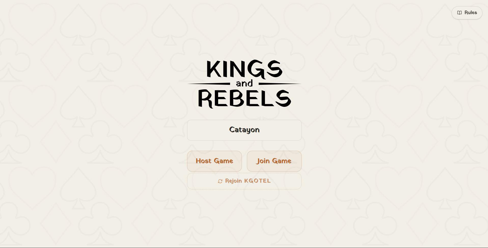
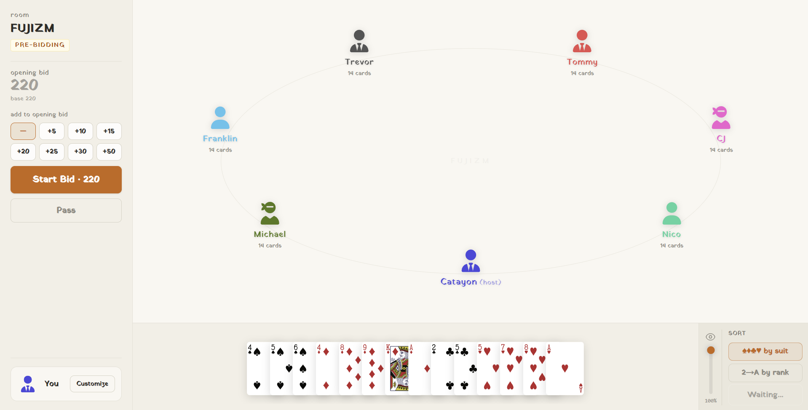
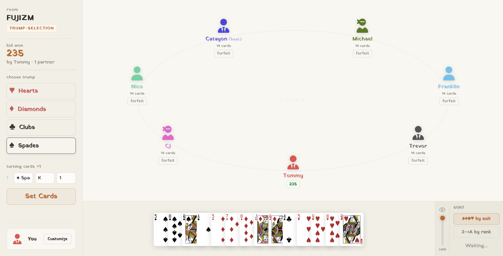
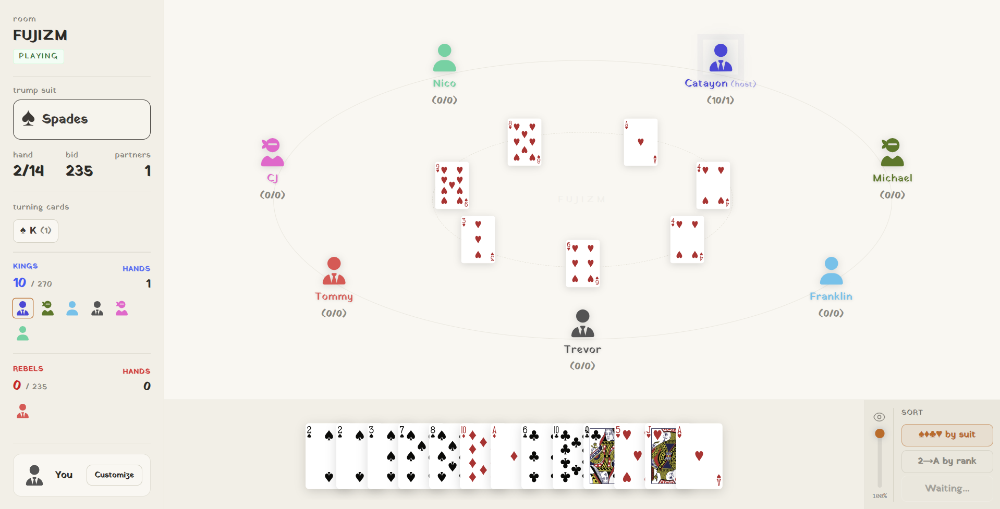
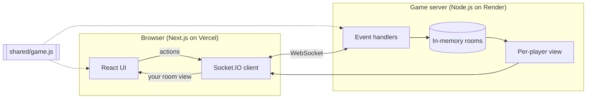

# Kings and Rebels

A real-time multiplayer trick-taking card game for 4 to 10 players, based on the traditional game *Three of Spades* (also called *250*). Players bid for the right to name trump, the winner secretly recruits partners through "turning cards", and nobody knows who's on which team until those cards hit the table.

**Play it:** [3ofspades.vercel.app](https://3ofspades.vercel.app/) · **Rules:** [/rules](https://3ofspades.vercel.app/rules)



| Bidding | Trump selection | Playing |
| --- | --- | --- |
|  |  |  |

## Features

- **Live multiplayer rooms.** Create a table, share a six-letter code or invite link, and play in real time over WebSockets.
- **Hidden information done properly.** Each player receives their own view of the game. Other hands never leave the server.
- **Seamless reconnects.** Refresh, lose signal or switch devices mid-game and you're put back in your seat with your cards.
- **Standard or custom rules.** Partner thresholds scale with table size, or the host can set their own minimum bid and partner ladder.
- **One or two decks**, including the two-deck rule for naming *which* copy of a duplicate card counts.
- **Helpful table UI.** Cards you can't legally play are dimmed, the winning card of each trick is highlighted, and the hand fans out to fit any screen.
- **Mobile friendly**, with a slide-out control panel and compact card layout.

## How it works



**The server is the single source of truth.** Clients only send intentions ("bid 160", "play the queen of hearts"). The server checks that it's that player's turn, that the move is legal and that the payload is well-formed, then updates the room and pushes fresh state to everyone.

**Every player gets a different view.** Rather than broadcasting the room object, the server builds a view per seat from an explicit allowlist of fields. Your own hand is included; other players only see how many cards you hold. Session tokens and connection ids are never sent to anyone.

**Rules are written once.** `shared/game.js` holds the scoring, partner thresholds, follow-suit check, trick resolution and dealing logic. The server uses it to enforce the rules, and the client uses the same functions to preview bids and grey out illegal cards, so the two can never disagree.

**Seats survive disconnects.** Joining a room issues a random seat token that the browser stores. Reconnecting with that token reclaims the seat, so all state is keyed by a stable seat id rather than the socket id. In the lobby a dropped player's seat is freed after 15 seconds. Once a game is underway the seat is held until they return, and if the host disappears, hosting passes to the next player.

**Built to take a bad message.** Every socket handler validates its input and runs inside an error boundary, so a malformed or hostile payload costs one ignored event instead of crashing the process. Events and room creation are rate limited per connection, payload size is capped, idle and abandoned rooms are swept automatically, and the deck is shuffled with a cryptographic RNG.

## Tech stack

| | |
| --- | --- |
| Front end | Next.js 16 (App Router), React 19, TypeScript, Tailwind CSS 4 |
| Realtime | Socket.IO 4 (WebSocket transport) |
| Game server | Node.js, no framework |
| Tests | Node's built-in test runner, including a full-game integration test against a live server |
| Hosting | Vercel (front end), Render (game server) |

## Project structure

```text
app/                  Next.js routes: home, /rules, /room/[roomId]
components/           UI components (cards, avatars, connection status)
  room/               Game table, hand, sidebar and one panel per game phase
lib/                  Client helpers: socket, types, card sorting, storage, hooks
shared/               Game rules and avatar options used by both client and server
server/
  socketServer.js     Entry point
  app.js              HTTP + Socket.IO server factory, health check, room sweeper
  handlers.js         Socket event handlers (one per player action)
  rooms.js            Room store, per-player view, shuffling
  validate.js         Input validation
  rateLimit.js        Per-connection rate limiting
test/                 Unit tests for the rules, integration tests for the server
```

## Running locally

Requires Node.js 20 or newer.

```bash
npm install
cp .env.example .env.local     # defaults work for local development

npm run dev:server             # game server on http://localhost:3001
npm run dev                    # web app on http://localhost:3000 (in a second terminal)
```

Open two or more browser windows (a private window works for a second player) to fill a table. The smallest table is four players.

| Script | What it does |
| --- | --- |
| `npm run dev` / `npm run dev:server` | Web app / game server with live reload |
| `npm test` | Rules unit tests and server integration tests |
| `npm run lint` · `npm run typecheck` | ESLint and TypeScript checks |
| `npm run build` · `npm start` | Production build and serve of the web app |
| `npm run start:server` | Run the game server in production |

## Configuration

| Variable | Used by | Purpose |
| --- | --- | --- |
| `NEXT_PUBLIC_SOCKET_URL` | Web app | URL of the game server |
| `NEXT_PUBLIC_SITE_URL` | Web app | Public site URL for link previews (optional) |
| `CLIENT_URL` | Game server | Allowed web app origin(s), comma-separated |
| `PORT` | Game server | Port to listen on (set automatically by most hosts) |

## Deployment

The web app and game server deploy separately:

- **Web app (Vercel):** standard Next.js project. Set `NEXT_PUBLIC_SOCKET_URL` to the game server's URL.
- **Game server (Render web service):** build command `npm install`, start command `npm run start:server`, health check path `/health`. Set `CLIENT_URL` to the web app's URL.

Game state lives in memory, so a server restart or redeploy ends any games in progress. On free hosting tiers the server sleeps when idle, and the UI tells players when the first connection is waiting for it to wake up.

## Socket events

### Client to server

| Event | Payload | Who |
| --- | --- | --- |
| `create-room` | `{ name, numPlayers, numDecks, isCustomRule?, customMinBid?, customPartnerThresholds? }`, ack `{ ok, roomId \| error }` | anyone |
| `join-room` | `{ roomId, name, token? }` | anyone |
| `leave-room` | `roomId` | seated player |
| `update-color` / `update-dress` | `{ roomId, color }` / `{ roomId, dress }` | seated player |
| `give-cards` · `start-bidding` | `roomId` | host |
| `pass-prebid` · `open-bid` | `roomId` · `{ roomId, extra }` | player whose turn it is to open |
| `place-bid` · `forfeit-bid` | `{ roomId, amount }` · `roomId` | current bidder |
| `confirm-trump` | `{ roomId, suit, turningCards, priorities? }` | winning bidder |
| `play-card` | `{ roomId, card }` | current player |
| `next-hand` · `restart-game` | `roomId` | host |

### Server to client

| Event | Payload |
| --- | --- |
| `room-update` | This player's view of the room |
| `session-token` | Seat token to store for reconnecting |
| `room-error` | Human-readable reason a request was refused |

## Ideas for later

- End-of-game stats (top scorer, best trick)
- Sound effects and richer card animations
- In-room chat
- Persisting rooms so games survive a server restart
